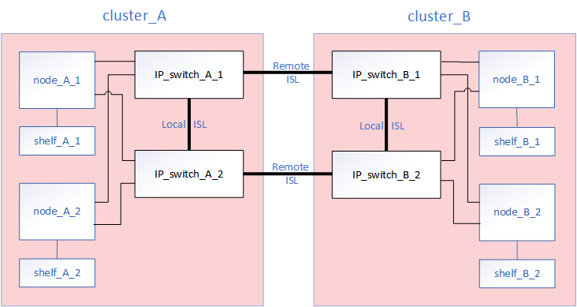
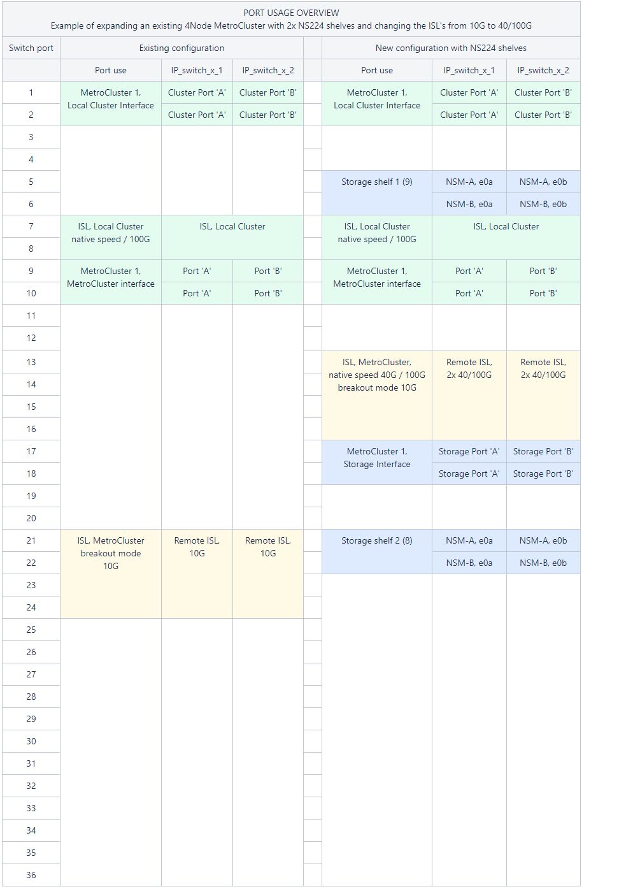

= Substitua ou reutilize um switch em uma configuração IP do MetroCluster
:allow-uri-read: 
:icons: font
:imagesdir: ../media/

[role="lead"]
Talvez seja necessário substituir um switch com falha, atualizar ou fazer downgrade de um switch ou alterar o uso de switches IP MetroCluster existentes.

CAUTION: Se você precisar realizar a substituição de um switch nas plataformas AFF A220, AFF A250 ou FAS2750, consulte link:https://kb.netapp.com/on-prem/ontap/mc/MC-KBs/Cluster_and_HA_communication_issues_during_back-end_switch_replacement["o artigo da Knowledge Base "Cluster and HA communication issues during back-end switch replacement""^].

.Sobre esta tarefa
Este procedimento aplica-se quando você está usando switches validados pela NetApp. Se você estiver usando switches compatíveis com MetroCluster, consulte o fornecedor do switch.

link:enable-console-logging-before-maintenance.html["Ativar o registo da consola"] antes de executar esta tarefa.

[NOTE]
====
Velocidades de link mistas não são suportadas em plataformas que usam uma placa de interface de rede X60134A. Para verificar se sua plataforma é afetada, consulte o  https://hwu.netapp.com/["Hardware Universe"^].

Se você estiver substituindo um switch que usa portas de 25G por um novo switch que usa portas de 100G em uma plataforma afetada (por exemplo, substituindo um switch BES-53248 por um switch Cisco 9336C em uma plataforma AFF A50), consulte link:https://kb.netapp.com/on-prem/ontap/mc/MC-KBs/100G_link_not_coming_online_during_MetroCluster_back-end_switch_replacement?caseId=2010523490["o artigo da Knowledge Base "100G link not coming online during MetroCluster back-end switch replacement""^].

====
Este procedimento suporta as seguintes conversões:

* Alterar o fornecedor, tipo ou ambos do switch. O novo switch pode ser o mesmo que o antigo switch quando um switch falhou, ou você pode alterar o tipo de switch (atualizar ou fazer downgrade do switch).
+
Por exemplo, para expandir uma configuração IP MetroCluster de uma configuração de quatro nós usando controladores AFF A400 e switches BES-53248 para uma configuração de oito nós usando controladores AFF A400, você deve alterar os switches para um tipo compatível para a configuração, pois os switches BES-53248 não são suportados na nova configuração.

+
Se você quiser substituir um switch com falha pelo mesmo tipo de switch, você só substitui o switch com falha. Se você quiser atualizar ou fazer downgrade de um switch, você deve ajustar dois switches que estão na mesma rede. Dois switches estão na mesma rede quando estão conetados com um link inter-switch (ISL) e não estão localizados no mesmo local. Por exemplo, a rede 1 inclui IP_switch_A_1 e IP_switch_B_1, e a rede 2 inclui IP_switch_A_2 e IP_switch_B_2, como mostrado no diagrama abaixo:

+

+

NOTE: Se você substituir um switch ou atualizar para diferentes switches, poderá pré-configurar os switches instalando o firmware do switch e o arquivo RCF.

* Converta uma configuração IP MetroCluster para uma configuração IP MetroCluster usando switches MetroCluster de armazenamento compartilhado.
+
Por exemplo, se você tiver uma configuração MetroCluster IP normal usando controladores AFF A700 e quiser reconfigurar o MetroCluster para conetar gavetas NS224 aos mesmos switches.

+
[NOTE]
====
** Se estiver adicionando ou removendo prateleiras em uma configuração MetroCluster IP usando switches IP MetroCluster de armazenamento compartilhado, siga as etapas em link:https://docs.netapp.com/us-en/ontap-metrocluster/maintain/task_add_shelves_using_shared_storage.html["Adição de gavetas a um IP MetroCluster usando switches MetroCluster de armazenamento compartilhado"]
** Sua configuração IP do MetroCluster pode já se conectar diretamente às gavetas NS224 ou a switches de storage dedicados.

====

[[port_usage_worksheet]]
.Folha de cálculo de utilização de portas
A seguir está uma Planilha de exemplo para converter uma configuração IP do MetroCluster para uma configuração de armazenamento compartilhado conetando duas prateleiras NS224 usando os switches existentes.

Definições da folha de cálculo:

* Configuração existente: O cabeamento da configuração MetroCluster existente.
* Nova configuração com NS224 gavetas: A configuração de destino em que os switches são compartilhados entre o storage e o MetroCluster.

Os campos realçados nesta folha de trabalho indicam o seguinte:

* Verde: Você não precisa alterar o cabeamento.
* Amarelo: Você deve mover portas com a mesma configuração ou uma configuração diferente.
* Azul: Portas que são novas conexões.

.Passos
. [[All_step1]]Verifique a integridade da configuração.
+
.. Verifique se o MetroCluster está configurado e no modo normal em cada cluster: `*metrocluster show*`
+
[listing]
----
cluster_A::> metrocluster show
Cluster                   Entry Name          State
------------------------- ------------------- -----------
 Local: cluster_A         Configuration state configured
                          Mode                normal
                          AUSO Failure Domain auso-on-cluster-disaster
Remote: cluster_B         Configuration state configured
                          Mode                normal
                          AUSO Failure Domain auso-on-cluster-disaster
----
.. Verifique se o espelhamento está ativado em cada nó: `*metrocluster node show*`
+
[listing]
----
cluster_A::> metrocluster node show
DR                           Configuration  DR
Group Cluster Node           State          Mirroring Mode
----- ------- -------------- -------------- --------- --------------------
1     cluster_A
              node_A_1       configured     enabled   normal
      cluster_B
              node_B_1       configured     enabled   normal
2 entries were displayed.
----
.. Verifique se os componentes do MetroCluster estão em bom estado: `*metrocluster check run*`
+
[listing]
----
cluster_A::> metrocluster check run

Last Checked On: 10/1/2014 16:03:37

Component           Result
------------------- ---------
nodes               ok
lifs                ok
config-replication  ok
aggregates          ok
4 entries were displayed.

Command completed. Use the "metrocluster check show -instance" command or sub-commands in "metrocluster check" directory for detailed results.
To check if the nodes are ready to do a switchover or switchback operation, run "metrocluster switchover -simulate" or "metrocluster switchback -simulate", respectively.
----
.. Verifique se não existem alertas de saúde: `*system health alert show*`

. Se a sua configuração IP do MetroCluster tiver gavetas NVMe conectadas aos switches IP do MetroCluster, execute os seguintes comandos para verificar o status das gavetas.
+
.. Mostre o status do shelf:
+
`storage shelf show`

+
.Mostrar exemplo
[%collapsible]
====
[listing]
----
cluster_A::> storage shelf show
                                                        Module  Operational
       Shelf Name Shelf ID Serial Number   Model        Type    Status
----------------- -------- --------------- ------------ ------- -----------
              1.0        0 952123456789    NS224NSM100  NSM100  Normal
              1.2        0 952987654321    NS224NSM100  NSM100  Normal
cluster_A::>
----
====
.. Mostre a conectividade das gavetas NVMe conectadas ao switch:
+
`storage shelf show -shelf <shelf_name> -connectivity`

+
.Mostrar exemplo
[%collapsible]
====
[listing]
----
cluster_A::> storage shelf show -shelf 1.0 -connectivity
            Shelf Name: 1.0
             Stack ID: 1
             Shelf ID: 0
            Shelf UID: 00:00:00:00:00:00:00:00
        Serial Number: 952123456789
          Module Type: NSM100
                Model: NS224NSM100
         Shelf Vendor: NETAPP
           Disk Count: 24
      Connection Type: NVMe
          Shelf State: Online
               Status: Normal
Paths:

Controller         Initiator Initiator Side Switch Port Target Side Switch Port    Target Port        TPGN
------------------ --------- -------------------------- -------------------------- ------------------ ------
cluster_A-01       0x        -                          0x                         05000005abff0000   67
cluster_A-02       0x        -                          0x                         030f0005abff0000   44

cluster_A::>
----
====
.. Caso necessário, colete os nomes dos dispositivos remotos (switch do MetroCluster):
+
.Mostrar exemplo
[%collapsible]
====
[listing]
----
cluster_A::> storage shelf port show -fields remote-device

shelf id remote-device
----- -- -------------
1.0   0  IP_switch_A_1
1.0   1  IP_switch_B_1
1.0   2  IP_switch_A_2
1.0   3  IP_switch_B_2
4 entries were displayed
----
====
.. Mostre a conectividade das portas da gaveta para as gavetas NVMe conectadas ao switch:
+
`storage shelf port show -remote-device <switch name>`

+
.Mostrar exemplo
[%collapsible]
====
[listing]
----
cluster_A::> storage shelf port show -remote-device IP_switch_A_1

Shelf ID Module State        Internal?
----- -- ------ ------------ ---------
1.0
       1 A      connected    false
       3 B      connected    false
1.2
       1 A      connected    false
       3 B      connected    false
4 entries were displayed.

cluster_A::>
----
====

. Configure o novo switch antes da instalação.
+
Se você estiver reutilizando switches existentes, prossiga para <<existing_disconnect,a etapa para desconectar as conexões do switch antigo>>.

+

NOTE: Se você estiver atualizando ou baixando os switches, deverá configurar todos os switches na rede.

+
Siga as etapas para o fornecedor do switch:

+
Certifique-se de aplicar o arquivo RCF correto para o switch _A_1, _A_2, _B_1 ou _B_2. Se o novo switch for o mesmo que o antigo, você precisará aplicar o mesmo arquivo RCF.

+
Se você atualizar ou baixar um switch, aplique o arquivo RCF mais recente suportado para o novo switch.

+
** link:../install-ip/task_switch_config_broadcom.html["Configurar switches IP Broadcom"]
** link:../install-ip/task_switch_config_cisco.html["Configurar switches IP Cisco"]
** link:../install-ip/task_switch_config_nvidia.html["Configurar switches IP NVIDIA"]

. link:../install-ip/switch-move-cluster-lifs.html["Mova os LIFs do cluster"].
+

NOTE: Você deve atualizar os switches na seguinte ordem: Switch_A_1, Switch_B_1, Switch_A_2, Switch_B_2. Você deve repetir os passos para mover os LIFs do cluster na segunda malha (Switch_A_2, Switch_B_2) depois de ter configurado os switches na primeira malha (Switch_A_1, Switch_B_1). Consulte link:../install-ip/task_install_and_cable_the_mcc_components.html["Saiba como configurar os switches IP do MetroCluster"].

. [[existing_disconnect]]Desconecte as conexões do switch antigo.
+

NOTE: Você só desconeta conexões que não estejam usando a mesma porta nas configurações antigas e novas. Se estiver a utilizar novos comutadores, tem de desligar todas as ligações.

+
Extrair as ligações pela seguinte ordem:

+
.. Desligue as interfaces do cluster local
.. Desligue as ISLs do cluster local
.. Desligue as interfaces IP do MetroCluster
.. Desligue os ISLs da MetroCluster
+
No exemplo <<port_usage_worksheet>>, os interrutores não mudam. Os ISLs da MetroCluster são relocados e devem ser desconetados. Não é necessário desligar as ligações marcadas a verde na folha de trabalho.

. Se você estiver usando novos switches, desligue o interrutor antigo, remova os cabos e remova fisicamente o interrutor antigo.
+
Se você estiver reutilizando switches existentes, prossiga para <<existing_configure,a etapa para configurar os switches existentes>>.

+

NOTE: *Not* cable os novos switches, exceto para a interface de gerenciamento (se usado).

. [[existing_configure]]Configure os switches existentes.
+
Se já tiver pré-configurado os parâmetros, pode ignorar este passo.

+
Para configurar os switches existentes, siga as etapas para instalar e atualizar os arquivos de firmware e RCF:

+
** link:https://docs.netapp.com/us-en/ontap-metrocluster/maintain/task_upgrade_firmware_on_mcc_ip_switches.html["Atualizando o firmware em switches IP MetroCluster"]
** link:https://docs.netapp.com/us-en/ontap-metrocluster/maintain/task_upgrade_rcf_files_on_mcc_ip_switches.html["Atualize arquivos RCF em switches IP MetroCluster"]

. Coloque o cabo dos interrutores.
+
Você pode seguir os passos em link:../install-ip/using_rcf_generator.html["Cable os switches IP MetroCluster"].

+
Ligue os interrutores pela seguinte ordem (se necessário):

+
.. Faça o cabo das ISLs para o local remoto.
.. Faça o cabo das interfaces IP do MetroCluster.
.. Faça o cabeamento das interfaces do cluster local.
+
[NOTE]
====
*** As portas usadas podem ser diferentes daquelas no switch antigo se o tipo de switch for diferente. Se você estiver atualizando ou baixando os switches, *NÃO* faça o cabo dos ISLs locais. Somente faça o cabeamento dos ISLs locais se você estiver atualizando ou baixando os switches na segunda rede e ambos os switches em um local forem do mesmo tipo e cabeamento.

====

. Ligue o interrutor ou os interrutores.
+
Se o novo switch for igual, ligue o novo switch. Se você estiver atualizando ou fazendo downgrade dos switches, ligue ambos os switches.

. Repita os passos anteriores para a segunda malha (Switch_A_2 e Switch_B_2) depois de ter atualizado a primeira malha (Switch_A_1 e Switch_B_1).
+

NOTE: Se você estiver substituindo um switch com defeito por um do mesmo tipo, basta atualizar o switch com defeito, sem precisar repetir as etapas para o segundo fabric.

. Finalizar o cabeamento do cluster local.
+
.. Se as interfaces de cluster locais estiverem conetadas a um switch:
+
... Faça o cabo das ISLs do cluster local.

.. Se as interfaces de cluster locais estiverem *não* conetadas a um switch:
+
... Utilize o link:https://docs.netapp.com/us-en/ontap-systems-switches/switch-bes-53248/migrate-to-2n-switched.html["Migrar para um ambiente de cluster comutado do NetApp"^]procedimento para converter um cluster sem switch em um cluster com switch. Use as portas indicadas em link:https://docs.netapp.com/us-en/ontap-metrocluster/install-ip/using_rcf_generator.html["Instalação e configuração IP do MetroCluster"] ou nos arquivos de cabeamento RCF para conectar a interface do cluster local.

. Verifique se a configuração do MetroCluster está saudável repetindo <<all_step1,Passo 1>>.
. Reverta todas as LIFs do cluster para sua porta inicial.
+

CAUTION: Não reverta as LIFs do cluster para suas portas iniciais até que você tenha concluído as etapas anteriores para todos os switches que precisam de uma atualização.

+
.. Modifique todas as LIFs do cluster para reativar a reversão automática:
+
[source, cli]
----
network interface modify -vserver <vserver_name> -lif <lif_name> -auto-revert true
----
.. Reverta manualmente todas as LIFs do cluster que não estão atualmente em suas portas iniciais para suas portas iniciais:
+
`network interface revert -vserver Cluster -lif *`

. Opcionalmente, mova as NS224 gavetas.
+
Se você estiver reconfigurando uma configuração IP do MetroCluster que não conete as gavetas NS224 aos switches IP do MetroCluster, use o procedimento apropriado para adicionar ou mover as gavetas NS224:

+
** link:https://docs.netapp.com/us-en/ontap-metrocluster/maintain/task_add_shelves_using_shared_storage.html["Adição de gavetas a um IP MetroCluster usando switches MetroCluster de armazenamento compartilhado"]
** link:https://docs.netapp.com/us-en/ontap-systems-switches/switch-cisco-9336c-fx2-shared/migrate-from-switchless-cluster-dat-storage.html["Migre de um cluster sem switch com storage de conexão direta"^]
** link:https://docs.netapp.com/us-en/ontap-systems-switches/switch-cisco-9336c-fx2-shared/migrate-from-switchless-configuration-sat-storage.html["Migre de uma configuração sem switch com storage conectado ao switch reutilizando os switches"^]

.Depois de terminar
link:../install-ip/task-configure-log-collection-mccip.html["Configurar coleta de logs em um switch IP do MetroCluster"]
